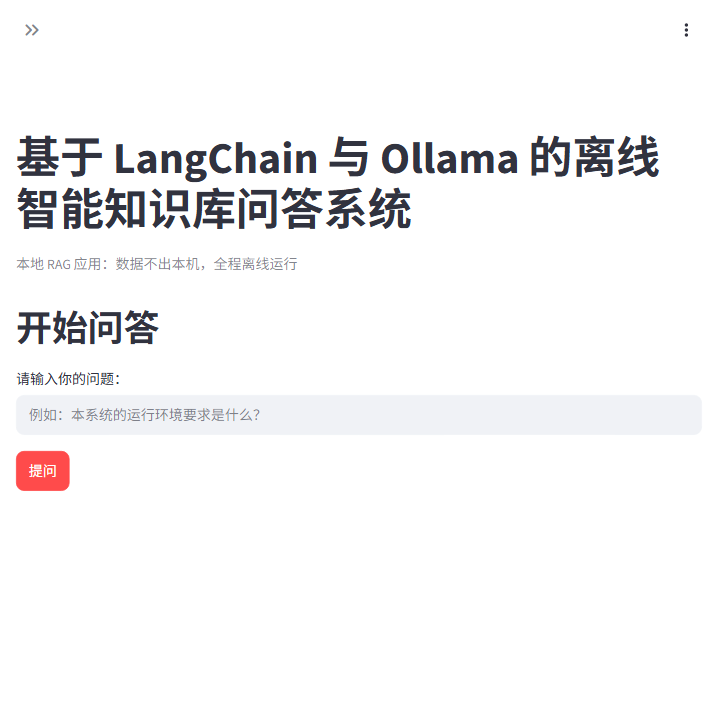
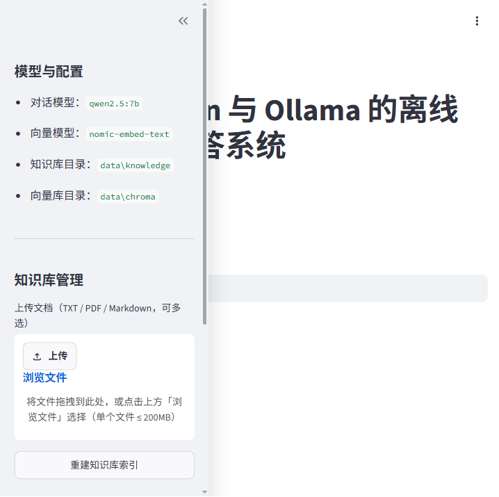

# 基于 LangChain 的智能知识库问答系统（离线 Ollama + 在线 DeepSeek 双模式）

> 一个基于 RAG（检索增强生成）的智能问答应用：导入 TXT / PDF / Markdown 文档构建私有知识库，通过 Chroma 向量检索 + 大模型生成回答。
支持两种推理模式：**离线模式**（本地 Ollama + qwen2.5:7b）与**在线模式**（DeepSeek 大模型，知识库检索仍在本地完成）。

- **开源仓库**：[https://github.com/zhangyy-neu/offline-langchain-rag](https://github.com/zhangyy-neu/offline-langchain-rag)
- **许可协议**：[MIT](./LICENSE)

---

## 一、项目简介

本项目基于 **LangChain 框架**与 **Ollama 离线大模型 + DeepSeek 在线大模型**，开发了一款面向个人与实验室场景的智能知识库问答应用。
用户只需把课程笔记、规章制度、操作手册等文档放入本地知识库，即可像使用 ChatGPT 一样向系统提问，系统会：

1. 从本地知识库中**检索**与问题最相关的文本片段；
2. 将检索结果与问题组合进 Prompt，交给大模型（离线 Ollama 或在线 DeepSeek）生成回答；
3. 返回回答的同时**标注参考来源**，保证回答可追溯。

应用提供 **命令行（CLI）** 与 **Streamlit 网页**两种交互界面，并内置不依赖模型的单元测试。

## 二、功能特性

- **双推理模式**：离线模式使用本地 Ollama（qwen2.5:7b），完全离线、数据不出本机；在线模式调用 DeepSeek 大模型，可回答知识库之外的通用问题，
知识库检索与向量化仍在本地完成；
- **多格式知识库**：支持 TXT、PDF、Markdown 三种常见文档格式，自动递归扫描目录；
- **中文友好**：文本切分针对中文标点优化，文档加载自动兼容 UTF-8 / GBK 编码；
- **可追溯回答**：每次回答附带参考来源与原文片段，便于核对；
- **双交互界面**：命令行 CLI 与 Streamlit 网页界面，网页端支持在线上传文档并一键重建索引；
- **配置灵活**：模型名、切分参数、检索数量等均可通过 `.env` 配置；
- **可测试**：内置不依赖模型的单元测试，便于持续集成与课程验收。

## 三、系统架构

```text
┌──────────────────────────────┐
│        用户交互层             │
│  Streamlit 网页 / 命令行 CLI  │
└──────────────┬───────────────┘
               │ 用户问题
               ▼
┌──────────────────────────────┐
│        LangChain 应用层       │
│  Prompt 模板 + 问答链 + RAG   │
└──────────────┬───────────────┘
               │ 检索相关内容
               ▼
┌──────────────────────────────┐
│        Chroma 向量数据库      │
│  存储本地知识库文本向量        │
└──────────────┬───────────────┘
               │
               ▼
┌──────────────────────────────┐
│        LangChain 应用层       │
│  Prompt 模板 + 问答链 + RAG   │
└──────────────┬───────────────┘
               │ 检索相关内容
               ▼
┌──────────────────────────────┐
│        Chroma 向量数据库      │
│  存储本地知识库文本向量        │
└──────────────┬───────────────┘
               │
               ▼
┌──────────────────────────────┐
│       大模型推理层（双模式）   │
│  离线：Ollama qwen2.5:7b     │
│  在线：DeepSeek deepseek-chat│
│  向量：qllama/bge-small-zh   │
└──────────────┬───────────────┘
               │
               ▼
┌──────────────────────────────┐
│        本地知识库              │
│       TXT / PDF / Markdown    │
└──────────────────────────────┘
```

## 四、系统工作流程

```text
1. 导入 TXT、PDF、Markdown 文件
              ↓
2. LangChain 加载本地文档
              ↓
3. RecursiveCharacterTextSplitter 切分文本
              ↓
4. Ollama Embedding 模型生成文本向量
              ↓
5. Chroma 保存向量数据
              ↓
6. 用户输入问题
              ↓
7. Chroma 检索相关文本片段
              ↓
8. LangChain Prompt 组合问题和上下文
              ↓
9. 大模型生成答案（离线 Ollama qwen2.5:7b / 在线 DeepSeek）
              ↓
10. 返回答案和参考来源
```

## 五、核心技术组成

| 模块 | 使用技术 |
| --- | --- |
| 应用框架 | LangChain（LCEL 问答链） |
| 离线大语言模型 | Ollama + Qwen2.5:7b |
| 在线大语言模型 | DeepSeek deepseek-chat（可选） |
| 向量模型 | qllama/bge-small-zh-v1.5（本地） |
| 向量数据库 | Chroma |
| 文档格式 | TXT、PDF、Markdown |
| 前端界面 | Streamlit |
| 检索方式 | RAG（检索增强生成） |
| 运行环境 | 默认本地离线运行，可切换在线推理 |

## 六、环境要求

| 依赖 | 版本要求 | 说明 |
| --- | --- | --- |
| Python | ≥ 3.10 | 开发验证环境为 Python 3.13 |
| Ollama | ≥ 0.3 | 本地模型运行服务 |
| qwen2.5:7b | - | 离线对话大模型，约 4.7 GB |
| qllama/bge-small-zh-v1.5 | - | 向量模型（中文优化，体积小） |
| 内存 | ≥ 8 GB | qwen2.5:7b 推理建议 8 GB 以上 |

> 说明：离线模式首次拉取模型需要联网，之后整个问答过程完全离线运行；在线模式需自行申请 DeepSeek API Key（免费额度足够课程演示）。

## 七、快速开始

### 1. 安装 Ollama 并拉取模型

从 [ollama.com](https://ollama.com) 下载并安装 Ollama，然后在终端执行：

```bash
# 拉取对话大模型（用于生成回答）
ollama pull qwen2.5:7b

# 拉取向量模型（用于文本向量化，中文优化）
ollama pull qllama/bge-small-zh-v1.5

# 验证
ollama list
```

### 2. 克隆项目并安装依赖

```bash
git clone https://github.com/zhangyy-neu/offline-langchain-rag.git
cd offline-langchain-rag

# 创建并激活虚拟环境（推荐）
python -m venv .venv
# Windows:
.venv\Scripts\activate
# macOS / Linux:
source .venv/bin/activate

# 安装依赖
pip install -r requirements.txt
```

### 3. 准备知识库文档

将你的文档放入 `data/knowledge/` 目录（支持 TXT / PDF / Markdown，可放子目录）。项目已附带三份示例文档：

```text
data/knowledge/
├── course.txt     # 计算机网络课程笔记
├── manual.md      # Ollama 离线部署与使用手册
└── rules.pdf      # 实验室系统使用规范
```

### 4. 构建知识库索引

```bash
python app.py build
```

输出示例：

```text
[1/3] 加载知识库文档：data/knowledge
      共加载 3 个文档。
[2/3] 切分文本……
      共切分为 9 个文本块。
[3/3] 生成向量并写入 Chroma……
完成：知识库索引已构建，可开始问答。
```

### 5. 开始问答

**方式一：命令行单次提问**

```bash
python app.py ask "TCP 三次握手的过程是什么？"
```

**方式二：命令行交互模式**

```bash
python app.py interactive
```

**方式三：Streamlit 网页界面**（推荐）

```bash
streamlit run web.py
```

浏览器自动打开网页界面后，即可输入问题提问；侧边栏支持在线上传文档、一键重建索引。

## 八、项目目录结构

```text
offline-langchain-rag/
├── app.py                       # LangChain 核心程序（命令行入口）
├── web.py                       # Streamlit 网页界面
├── requirements.txt             # 项目依赖
├── .env                         # 模型配置（本地私有，不提交）
├── .env.example                 # 配置模板
├── README.md                    # 项目说明文档
├── LICENSE                      # MIT 开源许可证
├── .gitignore                   # Git 忽略规则
│
├── data/
│   ├── knowledge/               # 本地知识库文件（TXT / PDF / Markdown）
│   │   ├── course.txt
│   │   ├── rules.pdf
│   │   └── manual.md
│   │
│   └── chroma/                  # Chroma 向量数据库（自动生成，不提交）
│
├── modules/
│   ├── __init__.py              # 模块包初始化
│   ├── model.py                 # 模型初始化（Ollama 离线 / DeepSeek 在线）
│   ├── loader.py                # 文档加载（TXT / PDF / Markdown）
│   ├── splitter.py              # 文本切分
│   ├── vector_store.py          # 向量数据库（Chroma）
│   ├── retriever.py             # 文档检索
│   └── qa_chain.py              # 问答链（Prompt + RAG）
│
└── tests/
    ├── __init__.py              # 测试包初始化
    └── test_qa.py               # 单元测试
```

## 九、配置说明

部署时复制 `.env.example` 为 `.env` 后按需修改（`.env` 已被 Git 忽略，不会提交到仓库，克隆后需自行创建）：

```bash
# Linux / macOS
cp .env.example .env
# Windows（PowerShell）
Copy-Item .env.example .env
```

| 配置项 | 默认值 | 说明 |
| --- | --- | --- |
| `OLLAMA_BASE_URL` | `http://localhost:11434` | Ollama 服务地址 |
| `LLM_MODEL` | `qwen2.5:7b` | 离线对话大模型名称 |
| `EMBEDDING_MODEL` | `qllama/bge-small-zh-v1.5` | 向量化模型名称（本地） |
| `DEEPSEEK_API_KEY` | 空 | DeepSeek API Key（在线模式必填） |
| `DEEPSEEK_BASE_URL` | `https://api.deepseek.com` | DeepSeek 接口地址 |
| `DEEPSEEK_MODEL` | `deepseek-chat` | DeepSeek 模型名称 |
| `CHUNK_SIZE` | `500` | 文本块最大字符数 |
| `CHUNK_OVERLAP` | `50` | 文本块重叠字符数 |
| `KNOWLEDGE_DIR` | `data/knowledge` | 知识库目录 |
| `CHROMA_DIR` | `data/chroma` | 向量数据库目录 |
| `RETRIEVER_K` | `4` | 每次检索返回的文本块数量 |

> 更换模型后需重新执行 `python app.py build`（或网页端「重建知识库索引」）重建索引。
> 在线模式使用说明：在 [DeepSeek 开放平台](https://platform.deepseek.com) 注册并创建 API Key，填入 `.env` 的 `DEEPSEEK_API_KEY` 后重启应用，
网页侧边栏「推理模式」选择「在线模式（DeepSeek）」即可。

## 十、运行测试

内置单元测试不依赖 Ollama 模型服务，可在离线环境直接运行：

```bash
python -m unittest tests.test_qa -v
```

覆盖范围：文档加载（UTF-8 / GBK / 无关文件过滤）、文本切分（长文切块 / 短文保留 / 元数据保留）、问答链来源格式化与参数校验。

## 十一、运行截图

**图 1：系统主界面**——展示系统标题与本地 RAG 特性说明，下方为问答输入区域与提问按钮。



<br>

**图 2：知识库管理界面**——左侧面板展示模型配置（对话模型 / 向量模型 / 目录）与知识库管理（文档上传、重建索引）。



## 十二、常见问题（FAQ）

**Q1：提示连接 localhost:11434 失败？**

答：确认 Ollama 服务已启动（`ollama list` 可正常执行），并检查端口 11434 未被占用。

**Q2：`python app.py build` 提示知识库没有文档？**

答：将 TXT / PDF / Markdown 文件放入 `data/knowledge/` 目录后重试。

**Q3：回答质量不理想？**

答：可增大 `CHUNK_SIZE` / `RETRIEVER_K` 或更换更大模型；注意文本切分参数修改后需重建索引。

**Q4：更换了对话模型但效果没变化？**

答：确认 `.env` 中 `LLM_MODEL` 已修改，且已执行 `ollama pull <新模型>` 与 `python app.py build`。

**Q5：向量数据库文件可以提交到 Git 吗？**

答：不可以，`data/chroma/` 已在 `.gitignore` 中忽略；克隆仓库后执行 `python app.py build` 即可重建。

## 十三、开源许可

本项目采用 [MIT License](./LICENSE) 开源许可，欢迎学习、使用与二次开发。

---


